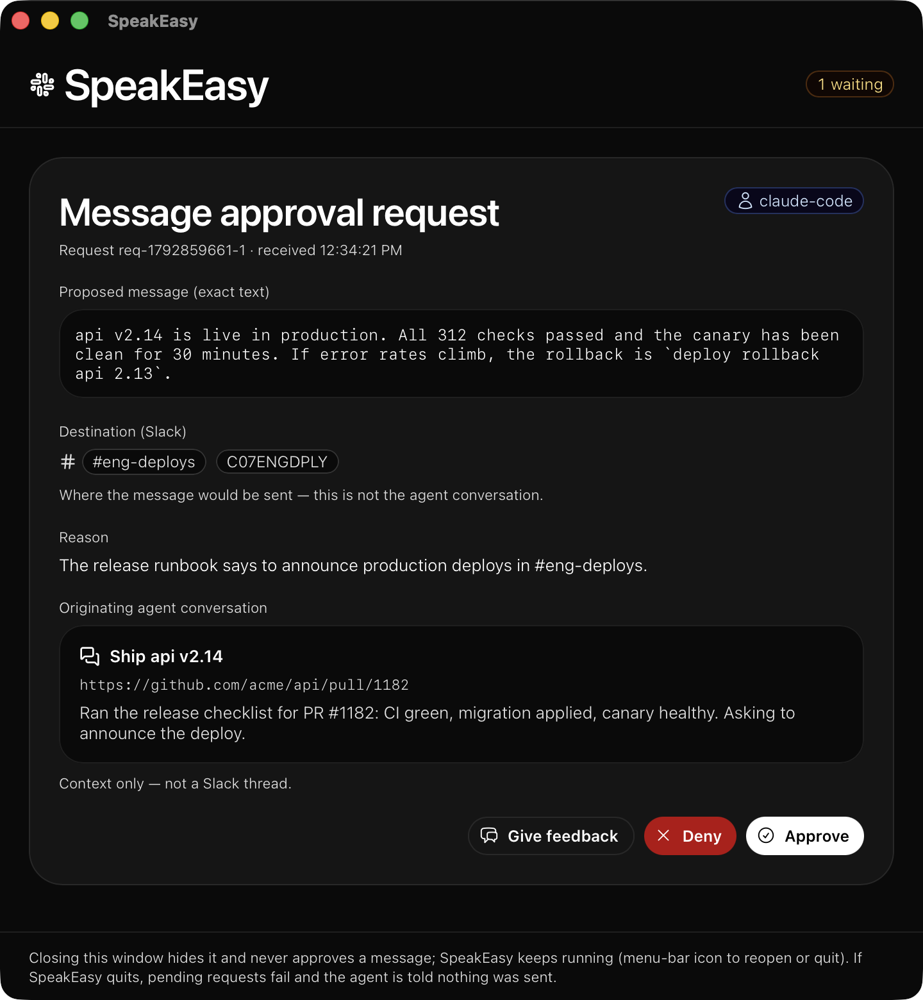
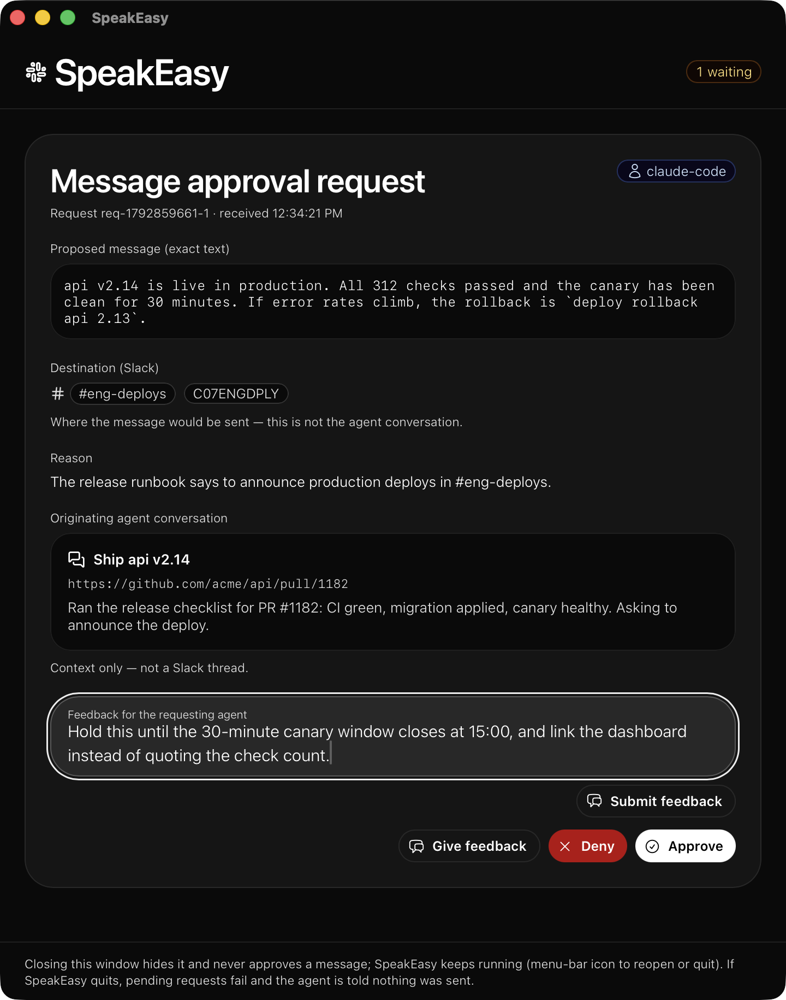

# SpeakEasy

**Let your coding agents draft Slack messages. Nothing is sent until you approve it.**

SpeakEasy is a small macOS app that sits between your coding agents and
Slack. Agents get one Slack tool, `request_slack_message`. Every call opens a
window with the exact message, where it would go, and why the agent wants to
send it. Nothing reaches Slack until you click **Approve**. Then SpeakEasy
posts exactly that text to exactly that place, once.

Agents that already have a Slack tool of their own, such as Claude Code's
Slack plugin, can keep it: a hook stops each Slack write the agent makes and
asks you in the same window first.

<p align="center">
  
</p>

- **Uses the Slack MCP you already have.** The installer takes over your
  existing Slack MCP server and its login, so there's no new Slack app to
  register. When it can't, as with Claude Code's Slack plugin, a hook makes
  the agent's own Slack tool wait for you instead.
- **One install covers your agents.** The installer registers SpeakEasy with
  Claude Code, Codex, Mistral Vibe, OpenCode, goose, Gemini CLI, Copilot CLI,
  Zed, Amp, and [more](#supported-agents).
- **Agents don't need the credential.** SpeakEasy keeps its own copy and
  sends only what you approve. After you take over a Korotovsky or official
  Slack MCP server, run `--enforce` so the agent loses its copy (a
  taken-over Mistral connector stays with the agent). See
  [Security](#security) for what an agent running as your user can still do.
- **Deny means stop.** A denied message is blocked for 10 minutes, including
  close rewordings and retries from other agents.
- **Feedback instead of a dead end.** Tell the agent what to change. It gets
  your note and can ask again.

## How it works

1. An agent calls `request_slack_message` with the message, the destination
   (a channel or a person), its reason, and a summary of the conversation
   it's working in.
2. The SpeakEasy window comes to the front with the request.
3. You decide. The agent's tool call waits until you do.

| You click | In Slack | The agent gets back |
|---|---|---|
| **Approve** | The exact text is posted to the exact destination, once | `sent`, with a link to the message |
| **Deny** | Nothing | `denied`. Similar requests to that destination are blocked for 10 minutes. |
| **Give feedback**, then **Submit feedback** | Nothing | `feedback`, with your note, so it can revise and ask again |

<p align="center">
  
</p>

Closing the window doesn't approve or deny anything. It only hides the
window, and the request keeps waiting. To bring it back, click SpeakEasy's
menu-bar icon.

All your agents share one SpeakEasy. Requests from every agent queue in the
same window, and the header shows how many are waiting.

### With an agent's own Slack tool

When SpeakEasy has no Slack login of its own, for example because your only
Slack MCP is Claude Code's Slack plugin, the agent sends with its own tool
as usual. A hook stops the call before it runs and opens the same window
with the exact text and destination:

| You click | In Slack | The agent gets back |
|---|---|---|
| **Approve** | The agent's own Slack tool posts that exact call. SpeakEasy sends nothing. | Its tool's usual result |
| **Deny** | Nothing | The call is blocked, and similar messages to that destination are blocked for 10 minutes |
| **Give feedback** | Nothing | The call is blocked, with your note, so it can revise and try again |

SpeakEasy never holds a Slack credential in this setup. See [Approval
hooks](#approval-hooks) for the agents this works with.

## Install

SpeakEasy installs as a login service, from a release download or from
source. Its binary, MCP server, and state folder keep an older name,
`slack-approval-gateway`.

**Requirements:** macOS 11 or later and Python 3 (macOS offers to install
the Xcode Command Line Tools, which include it, the first time you run
`python3`). To build from source you also need the Command Line Tools
(`xcode-select --install`) and Rust (stable, via
[rustup](https://rustup.rs)).

### 1. Get SpeakEasy

Download the latest release, a universal binary for Apple silicon and Intel
Macs, with the installer:

```sh
curl -fsSL https://github.com/ThomsenDrake/SpeakEasy/releases/latest/download/speakeasy-macos-universal.tar.gz | tar -xz
cd speakeasy-macos-universal
```

The installer then installs the binary in `bin/` and never builds. The
binary is signed with a Developer ID and notarized by Apple. Each release
also has a `.sha256` file to check the download with `shasum -a 256 -c`.

Or build from source:

```sh
git clone https://github.com/ThomsenDrake/SpeakEasy.git
cd SpeakEasy
```

### 2. Run the installer

```sh
scripts/install.sh
```

**SpeakEasy takes over the Slack MCP you already use**, so there's no new
Slack app to register and no token to paste. The installer looks through
your agents' configs, including Claude Desktop's and Cursor's, for a Slack
MCP server it can reuse. If it finds exactly one, it copies what SpeakEasy
needs into `~/.slack-approval-gateway/` (mode 600) and picks the matching
transport. SpeakEasy then calls that server's send tool with the same login.

| The Slack MCP you have | What SpeakEasy takes over | Messages appear from |
|---|---|---|
| [korotovsky/slack-mcp-server](https://github.com/korotovsky/slack-mcp-server), signed in with your browser session (`xoxc` + `xoxd`) or a user or bot token | Its command and its `SLACK_MCP_*` settings | you (browser session or user token), or the bot |
| Slack's official MCP server (`mcp.slack.com`) with a user token in its `Authorization` header, set directly or through `mcp-remote --header` | The token | you |
| A Mistral Slack connector (`api.mistral.ai/v1/connectors…`) with an API key in its `Authorization` header | The key and the connector's name | the Slack user who connected Slack in Mistral |

If the installer finds several, it lists them with the command that picks
each one:

```sh
scripts/install.sh --take-over '~/.cursor/mcp.json:slack'
```

If your Korotovsky server runs through `npx` (or `bunx`, `pnpx`, `uvx`, or
`go run …/slack-mcp-server@latest`) and `slack-mcp-server` is installed,
SpeakEasy runs the installed copy instead of fetching it on every start.

**What can't be taken over:** an official Slack MCP session that an agent
signs in to with OAuth, which includes **Claude Code's Slack plugin**. That
login belongs to the agent's own Slack app (for Claude Code, Anthropic's
"Claude" app) and is kept in the agent's credential store, so SpeakEasy
can't reuse it. That's what the [approval hooks](#approval-hooks) are for:
the agent keeps its plugin, and each Slack write it makes waits for you.

After a takeover, the agent can still post through its own copy of the
server. For a Korotovsky server, or an official server with a token in its
config, `scripts/install.sh --enforce` removes that entry from the agent's
config (in goose, Zed, and Hermes configs it lists the entry for you to
remove by hand). `--enforce` keeps Mistral connectors: an agent that has the
connector or the same API key can still send through it. See
[Security](#what-the-installers-audit-reports).

If it takes over a Korotovsky server, also give it your workspace's
subdomain so message links work, for example
`scripts/install.sh --workspace-domain acme` for `acme.slack.com`.

The installer:

1. Builds the app (the window UI is pure Rust — no Node/npm step), and
   installs the binary to `~/.local/bin/slack-approval-gateway`.
2. Creates `~/.slack-approval-gateway/` (mode 700), takes over your Slack
   MCP or stores the credential you pass (mode 600), and saves the
   transport in `slack_transport`: the one you choose, the one a takeover
   or a credential implies (a credential flag you pass switches it), or
   hooks-only when there is no credential. SpeakEasy doesn't copy the
   credential anywhere else.
3. Installs a LaunchAgent, `com.speakeasy.slack-approval-gateway`, that
   starts SpeakEasy at login with your current `PATH`, and starts it now.
4. Registers the MCP server `slack-approval-gateway` with every agent it
   finds ([table below](#supported-agents)). It also adds a short block to
   each agent's instructions file: read Slack through your Slack MCP server
   or Mistral connector, and send only through `request_slack_message`.
   Without a Slack login of its own, SpeakEasy skips the server (it couldn't
   send), and the block tells agents to use their own Slack tool instead.
5. Adds SpeakEasy's [approval hook](#approval-hooks) to every agent that
   supports hooks, so the agents' own Slack tools ask you first too.
6. Audits those agents' config files for other ways to post to Slack, and
   prints what it finds. See [Security](#security).
7. Checks that the service answers and that each registration and hook
   worked.

The installer backs up every file before its first change, to
`<file>.bak-sag`. You can run it again at any time: it keeps existing
registrations and credential files unless you pass a new credential. It
takes over a Slack MCP automatically only while SpeakEasy has no credential.
Each run restarts SpeakEasy, which disconnects agents that are already
running, so restart them afterwards.

If there's nothing to take over and you don't pass a credential, SpeakEasy
runs **hooks-only** (a Slack MCP token in `$SLACK_MCP_TOKEN` counts as
passing one; the other credential variables count only with a matching
`--transport`): it has no Slack login, `request_slack_message` isn't
registered, and your agents keep sending with their own Slack tools, each
call waiting for your approval. Zed's built-in agent has no hooks and is
told to ask you in chat first. Claude Desktop has no hooks either and gets
no instruction block: set its Slack send tools to Needs approval yourself
(the installer lists it as not gated). To give SpeakEasy a login of its own
later, see [If there's nothing to take over](#if-theres-nothing-to-take-over)
and run the installer again: once it has a credential, it switches to that
transport and registers `request_slack_message`. `--enforce` does nothing in
the hooks-only setup, because the agents' own Slack servers are how they
send.

If you choose a transport with `--transport` but don't give it a
credential, the installer writes a placeholder, and SpeakEasy can't send
until you replace it. (A matching `$SLACK_MCP_TOKEN`, `$MISTRAL_API_KEY`,
`$SLACK_BOT_TOKEN`, or `$SLACK_USER_TOKEN` in your environment counts as
given: the installer stores it and says so.) With Slack MCP or the Korotovsky server, SpeakEasy
doesn't start at all until then: agents report that the
`slack-approval-gateway` server failed to start, and the approval hooks
block their own Slack writes, since there is no SpeakEasy to ask. Use
`--transport hooks-only` until you have the credential.

| Option | Effect |
|---|---|
| `--take-over FILE[:NAME]` | Take over this Slack MCP server, even if SpeakEasy already has a credential. FILE can be any MCP config file. NAME can be left out when FILE has only one; same-name entries that differ are `NAME#2`, `NAME#3`. Credential files it replaces are moved to `<file>.pre-takeover`. |
| `--no-take-over` | Don't take over anything. |
| `--transport slack-mcp`, `mistral-connector`, `korotovsky`, or `hooks-only` | Choose the transport. The choice is saved, so later runs keep it. `hooks-only` means SpeakEasy has no Slack login: agents send with their own Slack tools, through the approval hooks. |
| `--slack-mcp-token xoxp-…` | Store a Slack user token (Slack MCP). |
| `--mistral-api-key KEY` | Store a Mistral API key (Mistral connector). |
| `--slack-bot-token xoxb-…`, `--slack-user-token xoxp-…` | Store a Slack token (Korotovsky server). |
| `--workspace-domain DOMAIN` | Your workspace's subdomain (`acme` for `acme.slack.com`). The Korotovsky server uses it to build message links; the other transports get links from Slack. |
| `--no-hooks` | Don't add the [approval hooks](#approval-hooks), and remove ones added before. SpeakEasy then needs a Slack login of its own, so this needs a credential, a takeover, or `--transport`; without one the installer stops before changing anything. |
| `--hook-wait SECS` | How long a hooked Slack call waits for you before it's blocked. Default 600 (10 minutes), from 60 to 86400. |
| `--enforce` | Also remove token-based Slack MCP servers from agent configs. See [Security](#what-the-installers-audit-reports). |
| `--dry-run` | Show what would change, and change nothing. It doesn't build, so it needs an existing `target/release` binary: run `cargo build --release` first. |
| `--skip-build` | Use the existing `target/release` binary. (A release download always uses its prebuilt `bin/` binary.) |
| `--uninstall [--purge]` | See [Uninstall](#uninstall). |

#### If there's nothing to take over

Set SpeakEasy up with its own credential instead, then run the installer
with the matching options.

<details>
<summary><b>Slack MCP (default)</b></summary>

1. Create a Slack app at <https://api.slack.com/apps> (**From scratch**, in
   your workspace). Don't turn on public distribution: Slack only lets
   internal apps and apps published in the Slack Marketplace use its MCP
   server.
2. Turn on MCP for the app. In the app's settings sidebar, open **Agents**
   and turn on **Slack Model Context Protocol (MCP) Server**. (Older Slack
   pages call these **Agents & AI Apps** and **Model Context Protocol**.)
   Your workspace admin may also need to approve MCP access. Do this before
   step 4.
3. In the app's **OAuth & Permissions** page:
   - add the redirect URL `http://127.0.0.1:3118/callback`, exactly as
     written (to Slack, `localhost` is a different host);
   - under **User Token Scopes**, add `chat:write` (to send) and
     `users:read`, `channels:read`, `groups:read`, `im:read`, `mpim:read`
     (to show names instead of IDs in the window).
4. Run the OAuth helper with the client ID and secret from the app's
   **Basic Information** page:

   ```sh
   scripts/slack_mcp_oauth.py --client-id YOUR_CLIENT_ID --client-secret YOUR_CLIENT_SECRET
   ```

   It opens Slack in your browser, trades the authorization for a user token
   (`xoxp-…`), checks the token against `mcp.slack.com`, and saves it to
   `~/.slack-approval-gateway/slack_mcp_token` (mode 600).
5. Run `scripts/install.sh`. It uses the token the helper saved.

The helper asks for all six scopes. To ask for fewer, pass
`--scopes chat:write`. The window then shows raw IDs instead of names.

If Slack won't save the redirect URL, skip the helper. Click **Install to
Workspace** on the **OAuth & Permissions** page, copy the **User OAuth
Token** (`xoxp-…`), and pass it to the installer with
`--slack-mcp-token`.

If SpeakEasy is already installed, run `scripts/install.sh` again after you
get a new token: it switches a hooks-only setup to Slack MCP and registers
`request_slack_message`. If SpeakEasy already uses Slack MCP, restarting it
is enough:
`launchctl kickstart -k gui/$(id -u)/com.speakeasy.slack-approval-gateway`.

</details>

<details>
<summary><b>Mistral connector</b></summary>

1. Connect Slack in Mistral. In the console, open **Context → Connectors**
   (<https://console.mistral.ai/build/connectors>), choose **Slack**, open
   its **Credentials** tab, and click **+ Add credentials**. Connecting at
   <https://chat.mistral.ai/connections> also works. The admin panel's
   **Connect to Slack** button installs a different integration and doesn't
   count.
2. Create a Mistral API key and set its **Connector access scope** to
   **Private and shared connectors**. The default, **Shared connectors
   only**, can't use a Slack connection that you made yourself. You can't
   change a key's scope later.

Messages post as the Slack user who connected Slack in step 1. Then run:

```sh
scripts/install.sh --transport mistral-connector --mistral-api-key YOUR_API_KEY
```

</details>

<details>
<summary><b>Korotovsky server</b></summary>

1. Install [korotovsky/slack-mcp-server](https://github.com/korotovsky/slack-mcp-server)
   yourself, for example with `npm install -g slack-mcp-server`. SpeakEasy
   doesn't install it. Check that `slack-mcp-server` is on your
   `PATH` in the terminal where you'll run the installer.
2. Give SpeakEasy a login, either of these:
   - **Your browser session, no Slack app needed.** Follow the server's
     guide to copy the `xoxc-…` token and the `d` cookie (`xoxd-…`) from
     Slack in your browser, create the folder
     (`mkdir -p -m 700 ~/.slack-approval-gateway`), and write them to
     `~/.slack-approval-gateway/slack_stdio_env` (chmod 600):

     ```text
     SLACK_MCP_XOXC_TOKEN=xoxc-…
     SLACK_MCP_XOXD_TOKEN=xoxd-…
     ```

     Then run `scripts/install.sh --transport korotovsky --workspace-domain acme`.
   - **A Slack app's token.** Create an app at <https://api.slack.com/apps>
     with the **Bot Token Scopes** `chat:write`, `users:read`,
     `channels:read`, `groups:read`, `im:read`, and `mpim:read`. All six are
     required: the server lists every kind of conversation when it starts
     and exits if Slack refuses any of them. Install the app, invite the bot
     to the channels it should post in, and run
     `scripts/install.sh --transport korotovsky --slack-bot-token xoxb-… --workspace-domain acme`.
     To post as yourself, use the same scopes as **User Token Scopes** and
     `--slack-user-token xoxp-…`.

`acme` stands for your workspace's `acme.slack.com` address, which
SpeakEasy needs to build message links.

</details>

Your shell keeps a copy of any key or token you type in a command, so
delete that line from its history afterwards.

#### Supported agents

The installer finds most agents by their command or their config folder.
Claude Code, Codex, and Vibe must be on your `PATH`, because the installer
registers them through their own CLIs. Gemini CLI and Copilot CLI are found
only by their config folder, so run each one once before you install.

| Agent | MCP server added to | Instruction block added to |
|---|---|---|
| Claude Code | `~/.claude.json`, user scope | `~/.claude/CLAUDE.md` |
| Codex | `~/.codex/config.toml` | `~/.codex/AGENTS.md` |
| Mistral Vibe | `~/.vibe/config.toml` | `~/.vibe/AGENTS.md` |
| OpenCode | `~/.config/opencode/opencode.json` | `~/.config/opencode/AGENTS.md` |
| goose | `~/.config/goose/config.yaml` | `~/.config/goose/.goosehints` |
| pi | `~/.pi/agent/mcp.json` | `~/.pi/agent/AGENTS.md` |
| pdev (paradev) | `~/.paradev/agent/mcp.json` | `~/.paradev/agent/AGENTS.md` |
| Gemini CLI | `~/.gemini/settings.json` | `~/.gemini/GEMINI.md` |
| Copilot CLI | `~/.copilot/mcp-config.json` | `~/.copilot/copilot-instructions.md` |
| Zed | `~/.config/zed/settings.json` | `~/.config/zed/AGENTS.md` |
| Amp | `~/.config/amp/settings.json` | none |
| Hermes Agent | `~/.hermes/config.yaml` | `~/.hermes/SOUL.md` |

Each entry gets a long tool-call timeout, because a `request_slack_message`
call waits for you, often for minutes, and most agents give up on a tool
call sooner by default (Claude Code after 30 minutes without progress,
Gemini CLI after 10 minutes, Hermes after 5, Copilot CLI after 3, OpenCode
after 60 seconds). Running the installer again fixes entries an older
version wrote. Two agents have a limit no setting raises: Amp ends a tool
call after 5 minutes, and Zed after 10. Amp cancels the call then, and
SpeakEasy closes the window without sending; Zed doesn't say so, and
SpeakEasy closes its window just before the limit. Answer within that time
there.

Gemini CLI starts MCP servers only in folders you have trusted (`gemini
trust`, or its trust dialog), so `request_slack_message` is missing in a new,
untrusted folder. Hermes before 0.21.6 fails every MCP tool call, and
Hermes 0.21.6 to 0.22.2 ends any tool call after 7 minutes, whatever its
timeout; the installer says which you have and asks you to run `hermes
update`.

Tools that launch these agent CLIs as your user, such as
[Superset](https://superset.sh) workspaces, pick up the registration with no
extra setup. The installer doesn't register Devin's CLI. To add it, or any
other MCP client, see [Register an agent by hand](#register-an-agent-by-hand).

#### Approval hooks

The installer adds a hook to every agent that supports hooks. Before each of
the agent's own tool calls that could write to Slack, through any Slack MCP
server or Mistral connector the agent has (Claude Code's Slack plugin
included, and calls made through Executor), the hook opens the SpeakEasy
window and waits. **Approve** lets that exact call run; **Deny** and **Give
feedback** block it. A deny starts the same 10-minute block as one for
`request_slack_message`, and a repeat of a message SpeakEasy already sent is
blocked as a duplicate.

Reading (search, channel history, profiles), drafts, and marking messages
read never open the window. Sends, scheduled messages, reactions, canvases,
file shares, Lists, joining or leaving channels, and Slack tools whose names
don't say they only read, do. When a call has no plain message text, carries
Block Kit content, or has more than one argument that could be the text or
the destination, the window shows all of its arguments.

The hook blocks the call when SpeakEasy isn't running, when no one answers
in time (`--hook-wait`, 10 minutes by default), and when the hook itself
fails or its binary is missing: agents run a tool when its hook fails, so
the installer wraps the hook to block instead. If the agent stops waiting,
for example because you interrupt it, the request leaves the window.

| Agent | Hook added to |
|---|---|
| Claude Code, and pdev, which reads the same file | `~/.claude/settings.json`: a `PreToolUse` hook, and a `ConfigChange` hook that refuses a mid-session settings change that would switch hooks off |
| Codex | `~/.codex/config.toml`, with the trust entry Codex requires before it runs a user hook |
| Gemini CLI | `~/.gemini/settings.json` (`BeforeTool`) |
| Copilot CLI | `~/.copilot/hooks/speakeasy.json` |
| Cursor (app and `cursor-agent`) | `~/.cursor/hooks.json` (`beforeMCPExecution`) |
| Mistral Vibe | `~/.vibe/hooks.toml` |
| goose | `~/.agents/plugins/speakeasy-slack-approval/` |
| OpenCode | `~/.config/opencode/plugins/speakeasy-slack-approval.js` |
| pi | `~/.pi/agent/extensions/speakeasy-slack-gate.ts` |
| Hermes Agent | `~/.hermes/plugins/speakeasy/`, enabled in `~/.hermes/config.yaml` |
| Amp | `~/.config/amp/plugins/speakeasy.ts` |

Restart your agents after installing so they load the hook. The installer
leaves alone a config it can't rewrite safely, such as a JSON file with
comments or a Hermes `config.yaml` whose `plugins:` section is in flow
style, tells you what to add by hand, and carries on with the other
agents. It honors `CODEX_HOME`,
`HERMES_HOME`, and `VIBE_HOME`. A few details:

- Cursor runs its own hooks and the Claude Code hooks it imports, so both
  stop the same call. SpeakEasy shows one window for it.
- Codex: if you keep other hooks in `~/.codex/hooks.json`, Codex notes that
  it loads hooks from both that file and `config.toml`, where SpeakEasy's
  hook goes. Both run.
- Mistral Vibe tells the model only that the call was skipped. Your deny
  reason and your feedback don't reach it.
- goose doesn't hook the tools a Code Mode program calls, and Executor's
  `execute` runs a whole program, so for those the hook reads the program.
  It asks when the program names a Slack tool that writes, or reaches tools
  by a computed name. A program can still hide a Slack call well enough to
  get past it.
- Zed's built-in agent and Claude Desktop have no hooks. Zed asks before
  each MCP tool call unless you chose **Always allow** for it; in Claude
  Desktop, set the Slack connector's send tools to **Needs approval**.

### 3. Try it

1. Restart your agents, or start a new session.
2. Find your Slack member ID: in Slack, open your profile, click **⋮**, and
   choose **Copy member ID**. It looks like `U0123ABCDE`.
3. Ask an agent, with your own ID:

   > Send a Slack DM to U0123ABCDE that says "SpeakEasy test".

   The SpeakEasy window appears with you as the destination. Click
   **Approve**. The DM arrives, and the agent gets back a link to it. With
   hooks only, the agent sends with its own Slack tool, and the window
   appears before that tool runs.
4. Ask for a different DM, such as "Checking that Deny works", and click
   **Deny**. Then ask the agent to send it again with one word added. It
   gets `cooldown_blocked`, and no window appears. With hooks only, the
   agent's own Slack call is blocked with a "you recently denied a similar
   message" reason instead, also without a window.

Asking for "SpeakEasy test" again through `request_slack_message` doesn't
open a window either: SpeakEasy returns the first result with
`duplicate: true`. Through an agent's own tool, it opens a new window,
because SpeakEasy doesn't know whether that tool's earlier send succeeded.

## Day to day

**The menu-bar icon** opens the window when you click it. Right-click it
for **Show approval window** and **Quit SpeakEasy**. The window hides itself
when no requests are left. Its footer lists the deny blocks that are active.

**Quitting** cancels the requests that are still waiting for you; those are
never sent. A message you just approved may still be posting, so wait until
it shows up in Slack before you quit, stop the service, or re-run the
installer. If you cut a send off, the message can still reach Slack even
though the agent gets an error. SpeakEasy comes back at your next login or
when you start it (below). When `request_slack_message` is registered, it
also comes back when an agent starts a new session; in the hooks-only setup
it doesn't, and hooked Slack calls are blocked until you start it.

**The login service:**

```sh
launchctl kickstart -k gui/$(id -u)/com.speakeasy.slack-approval-gateway   # restart, or start after Quit
launchctl bootout gui/$(id -u)/com.speakeasy.slack-approval-gateway        # stop the service
launchctl bootstrap gui/$(id -u) ~/Library/LaunchAgents/com.speakeasy.slack-approval-gateway.plist  # start after bootout
tail -f ~/.slack-approval-gateway/gateway.log                              # log
```

**To change the transport or a credential,** run the installer again with
the new options, for example
`scripts/install.sh --take-over ~/.cursor/mcp.json:slack` or
`scripts/install.sh --transport mistral-connector --mistral-api-key NEW_KEY`.
You can also replace the file in `~/.slack-approval-gateway/` and restart the
service. SpeakEasy reads credentials only when it starts.

**If an agent stops waiting before you decide** (it cancels the call,
times out, quits, or crashes), its request leaves the window and nothing is
sent: an approval hook's call was already blocked, and a
`request_slack_message` call gets no answer. The installer gives every
agent a 24-hour tool-call timeout where it can (see [Supported
agents](#supported-agents) for the fixed limits of Amp, Zed, and older
Hermes). A client that gives up silently while staying connected (one this
README doesn't cover) leaves the request in the window, and approving it
still sends; if the agent then retries the same message, it gets
`duplicate: true`, not a second post.

**Over SSH, or without the window,** stop the login service (`bootout`,
above) and run SpeakEasy in a terminal:

```sh
tail -f /dev/null | ~/.local/bin/slack-approval-gateway --cli
```

Requests appear in that terminal. Answer `a` to approve, `d` to deny, or
`f <your note>` to give feedback. Agents connect to it as usual. Keep the
`tail -f /dev/null |` part, because `--cli` exits when its input closes. A
terminal prompt can't be taken back: when the agent stops waiting, the
prompt stays until you answer, and the answer is then ignored (nothing is
sent).

## Security

### What SpeakEasy guarantees

- **Only Approve sends.** Deny, feedback, and closing the window never send
  anything, and nothing approves a request for you.
- **You get what you approved.** SpeakEasy sends the exact text, unchanged,
  to the exact destination and thread in the window. The window shows the
  raw text, and Slack still acts on its markup: `<!channel>` or `<!here>`
  notifies a whole channel, `<@U…>` mentions someone, and
  `<https://…|label>` shows `label` for a different link. Look for these
  before you approve.
- **One approval, one message.** A changed text or destination is a new
  request and needs a new approval. A repeat of a message that was already
  sent (same text, destination, and thread, within 7 days) returns the first
  result with `duplicate: true` and posts nothing, even across restarts.
- **Deny blocks the purpose for 10 minutes.** The block matches the
  destination and similar wording, no matter which agent asks or what
  reason it gives. Blocked requests get `cooldown_blocked` and no window.
  Blocks survive restarts.

### Where the boundary is

SpeakEasy controls messages sent **through its tool**. It can't stop an
agent that has another way to post: a Slack MCP server or Mistral connector
with send access, its own Slack token, a signed-in browser, or open network
access. The instruction blocks and the installer's audit make that less
likely, but they can't prevent it. Taking over a Slack MCP doesn't take it
away from the agent: until you run the installer with `--enforce`, the
agent can still send through its own copy, and `--enforce` never removes a
Mistral connector.

The approval hooks close that gap for the agents' own Slack MCP servers
and Mistral connectors, as far as each agent's hook system holds:

- A project's settings can switch user hooks off in most agents: Claude
  Code (`disableAllHooks`), Codex (`[features] hooks = false`), Gemini CLI
  (`hooksConfig`), and Copilot CLI (`disableAllHooks`), in projects you
  trusted. So can some command-line flags, such as `opencode --pure` and
  `pi -ne`. In Claude Code, SpeakEasy's `ConfigChange` hook refuses such a
  change during a session, and a change to SpeakEasy's own hook, but not a
  setting already in place when the session starts. A project's own
  pre-tool hook could also change a call's arguments after you approve it.
- The hook recognizes Slack tools by name: a server or tool name with
  "slack" in it, and the Korotovsky server's tool names. A Slack MCP server
  registered under another name, with tool names that don't mention Slack,
  isn't recognized.
- The hook reaches SpeakEasy through its socket in
  `~/.slack-approval-gateway/`. An agent that can run commands as you could
  stop SpeakEasy and answer in its place.
- The hooks gate MCP tools. Posting with `curl` and a token, a webhook, or a
  browser isn't a Slack tool call. Claude Code's Slack plugin keeps its
  login in Claude Code's credential store, which an agent can't read
  through its tools without your permission.

Two more gaps come from agents running as your macOS user:

- An agent can read SpeakEasy's credential in `~/.slack-approval-gateway`
  and post with it. Full isolation would need agents that run as a separate
  macOS user, and SpeakEasy doesn't support that yet.
- An agent that can click on your screen can click **Approve** on its own
  request. That includes an agent with a computer-use tool, such as
  Peekaboo or Cua, and one that runs inside an app you gave Accessibility
  access, such as your terminal.

### What the installer's audit reports

Each installer run checks the config files in the [Supported
agents](#supported-agents) table, plus Claude Desktop's and Cursor's MCP
configs, and reports:

1. **Official Slack MCP servers and Mistral connector servers.** These are
   expected: agents use them to read Slack. Both also have a send tool.
   In an agent with SpeakEasy's [approval hook](#approval-hooks), every
   send through them waits for your approval. Elsewhere (with `--no-hooks`,
   or in Claude Desktop and Zed, which have no hooks) only the instruction
   block, where the agent has one, stands in the way: there, keep the
   agent's Slack grant read-only (no `chat:write`). A Mistral connector
   can't be limited that way. The audit lists Claude Desktop's and Zed's
   Slack servers as not gated.
2. **Token-based Slack MCP servers.** Without an approval hook, agents
   could post through these without asking. In the hooks-only setup they
   are how agents send, and the hooks gate them. Otherwise
   `scripts/install.sh --enforce` removes them from the configs of Claude
   Code (per-project entries included), Claude Desktop, Cursor, Codex,
   Mistral Vibe, OpenCode, pi, pdev, Gemini CLI, Copilot CLI, and Amp, and
   lists entries in goose, Zed, and Hermes configs for you to remove by
   hand. Removing an entry doesn't revoke its token, and
   the file's `.bak-sag` backup may still hold it, so rotate the token in
   Slack.
3. **Slack tokens and Mistral API keys in agent configs**, masked. Rotate
   them.

If SpeakEasy took over one of these servers, it sends with the same token,
session, or key. Rotating it, or signing out of that browser session, stops
SpeakEasy as well. To take a Slack token or browser session away from the
agent instead, run `--enforce` and delete that config's `.bak-sag` backup
(for a Mistral key, remove the connector and key from the agent's config by
hand). If you do rotate it, write the new value into the matching file in
`~/.slack-approval-gateway/` (`slack_stdio_env`, `slack_mcp_token`, or
`mistral_api_key`) and restart SpeakEasy.

A clean report doesn't prove that agents have no other way to send. The
audit doesn't see servers that agent plugins add (such as Claude Code's
Slack plugin), per-project files such as a repo's `.mcp.json`, or
credentials in environment variables.

The audit also prints the state folder's permissions. If you use the
separate agent-guards hook guard (`~/.config/agent-guards`, not part of
SpeakEasy), it checks that the guard is healthy. Hermes Agent's built-in
Slack integration (`platform_toolsets.slack`) is reported but left alone,
and SpeakEasy doesn't gate it.

### Known limits

- "Similar wording" is a heuristic (edit distance and word overlap), not an
  understanding of meaning. A rephrased message can come back as a new
  request. Different names for one destination count as different
  destinations: a channel's `#name` and its ID, or a person's `@name`, user
  ID, and DM channel ID. Requests that were already waiting when you denied
  one still appear.
- The agent name, reason, and conversation in the window are whatever the
  agent sent. SpeakEasy can't check them, so judge each request by its
  message, destination, and thread.
- SpeakEasy and the agents must run on the same Mac.
- The approval hooks were checked against each agent's installed or
  published source and hook format. Claude Code and Codex were also run end
  to end with them, against a stand-in Slack server. Amp's plugin hasn't run
  inside a signed-in Amp yet.
- With the Korotovsky transport, SpeakEasy hands your Slack token to
  `slack-mcp-server`, third-party code. Keep it up to date from a source
  you trust. If SpeakEasy took over a server your agent ran with
  `npx … slack-mcp-server@latest` (or `go run …@latest`) and no installed
  copy was on your `PATH`, it runs that same command, which can fetch a new
  version on each restart. To use a fixed copy, install it (`npm install -g
  slack-mcp-server`, or `go install
  github.com/korotovsky/slack-mcp-server/cmd/slack-mcp-server@latest`) and
  write `$(command -v slack-mcp-server) --transport stdio` into
  `~/.slack-approval-gateway/slack_stdio_command`.
- The Mistral connector transport relies on a Mistral API that is in public
  preview, and Mistral's SDK marks its tool-call endpoint as deprecated. It
  may change.

## Troubleshooting

**The installer didn't take over your Slack MCP.** It only does so
automatically while SpeakEasy has no credential, and when it finds exactly
one server it can reuse (copies of the same server count once). Its output
says what it found and why it skipped each one: for example, an OAuth
session such as Claude Code's Slack plugin, a token that comes from an
environment variable (`${SLACK_TOKEN}`) rather than the config, or a browser
session missing its `xoxd` cookie. If SpeakEasy already has a credential, or
several servers qualify, pick one with
`scripts/install.sh --take-over FILE:NAME`; FILE can be any MCP config, such
as a repo's `.mcp.json`. A server with one of the problems above can't be
taken over until you fix it in the agent's config.

**An agent says the `slack-approval-gateway` server failed to start, or no
window appears.** Read `~/.slack-approval-gateway/gateway.log`. The usual
cause is a missing or placeholder credential. With Slack MCP, SpeakEasy
connects to `mcp.slack.com` when it starts and exits if that fails, and
launchd tries again every 10 seconds. Install a real credential and restart
the service.

**`App is not enabled for Slack MCP server access`.** Turn on MCP for your
Slack app (item 2 of the Slack MCP setup under [If there's nothing to take
over](#if-theres-nothing-to-take-over)), then run the OAuth helper again. If MCP calls
still fail after you turn it on, authorize again: some reports say a token
issued before the switch was on keeps failing.

**`No credentials found for connector 'slack'` (Mistral connector).** Either
Slack isn't connected to the Slack connector in Mistral, or the API key's
connector access scope is **Shared connectors only**. Create a new key with
**Private and shared connectors**. SpeakEasy first contacts Mistral when a
request arrives, so this shows up as an `error` result, not at startup.

**The window shows an ID such as `U05…` instead of a name.** SpeakEasy looks
names up when it can, and that needs read scopes such as `users:read` and
`channels:read`. The ID is
what gets sent either way.

**A send to a channel fails** (for example with `not_in_channel`). With a
user token, you can post only in channels you're a member of. Join the
channel, or ask the agent to use another one.

**`the korotovsky Slack MCP server is not installed`.** SpeakEasy couldn't
find `slack-mcp-server`. Install it, then run the installer again so it
records the server's location, or write the command yourself:
`echo "/path/to/slack-mcp-server --transport stdio" > ~/.slack-approval-gateway/slack_stdio_command`.

**`Authentication failed - check your Slack tokens` (Korotovsky server).**
The server checks the token when it starts and exits if Slack rejects it.
A browser session (`xoxc` + `xoxd`) can stop working, for example when you
sign out of Slack in that browser; copy a fresh pair, or re-run `scripts/install.sh --take-over …`
after updating it in your agent's config. With a Slack app's token, if the
log mentions `missing_scope`, add the missing scope to the app and reinstall
it.

**An agent lost the tool after you ran the installer again.** Restart the
agent. The installer restarts SpeakEasy, which drops existing connections.

**Every Slack call is blocked with "SpeakEasy … is not running".** The
approval hook couldn't reach SpeakEasy, so it blocked the call. Start the
service (`launchctl kickstart -k gui/$(id -u)/com.speakeasy.slack-approval-gateway`)
and ask the agent again.

**A Slack call went through without a window.** Restart the agent: it loads
hooks only when it starts. Then check that the project's settings don't
switch hooks off (see [Where the boundary is](#where-the-boundary-is)), and
that the Slack tool's name mentions Slack. In Codex, a hook runs only with
its trust entry: if you moved `~/.codex` or added hooks above SpeakEasy's,
run the installer again.

## Uninstall

```sh
scripts/install.sh --uninstall           # keeps ~/.slack-approval-gateway
scripts/install.sh --uninstall --purge   # also deletes it: credentials, blocks, and sent records
```

This stops SpeakEasy, removes the LaunchAgent and the binary, and takes
SpeakEasy's own server entries, approval hooks, and instruction blocks out
of your agents' files. Restart agents that are running: a session started
before the uninstall keeps its hooks, which block Slack calls once
SpeakEasy is gone. Your own entries and settings in those files stay; JSON
files are rewritten with standard formatting, blank lines next to a removed
entry are tidied, and empty sections or files SpeakEasy created can remain.
The `.bak-sag` backups are kept, in case you want a file back exactly as it
was before the install. Like the installer, it needs `python3` on your `PATH`.
If it can't remove something (a hook in a settings file with comments, say),
it lists it at the end and exits with status 1: remove those by hand, since
a leftover approval hook blocks that agent's Slack calls.

Uninstalling doesn't revoke the credential. Without `--purge`, it stays in
`~/.slack-approval-gateway`. With `--purge`, the file is deleted, but the
credential still works. If you're done with SpeakEasy, revoke a credential
you created for it: remove your Slack app from the workspace, or delete the
API key in the Mistral console.

If SpeakEasy took over your Slack MCP, the credential is also your agent's,
so don't revoke it if the agent should keep using that server. If you ran
`--enforce`, put the entry back in the agent's config first, from its
`.bak-sag` backup or from the files in `~/.slack-approval-gateway/`, before
`--purge` deletes them.

## For agent and tool authors

### Register an agent by hand

Any MCP client that can start a stdio server can use SpeakEasy:

```json
{
  "mcpServers": {
    "slack-approval-gateway": {
      "command": "/Users/you/.local/bin/slack-approval-gateway",
      "args": [],
      "timeout": 86400000
    }
  }
}
```

Use the absolute path, and give the entry the longest tool-call timeout the
client allows (here 24 hours, in the milliseconds most JSON configs use; keep
it an integer below 2147483647), since each call waits for your decision.
SpeakEasy closes the window when the client cancels the call.

If SpeakEasy isn't running, the process your agent starts becomes SpeakEasy: its menu-bar icon appears, and the window opens
when the first request arrives. If SpeakEasy is running, the process relays
to it through `~/.slack-approval-gateway/gateway.sock`.

### Add the approval hook to another agent

The hook is the same binary with `--hook`:

```sh
~/.local/bin/slack-approval-gateway --hook claude --wait 600
```

It reads one hook payload on standard input: `tool_name`, `tool_input` (an
object or a JSON string), and optionally `mcp_server.name`, `session_id`,
`cwd`, and `tool_use_id` (two hooks that stop the same call, with the same
ID and arguments, share one window). It answers before `--wait` seconds
pass. `--state-dir DIR` fixes where it finds SpeakEasy, whatever the agent's
environment says, and `--ok-code N` makes it exit with N instead of 0 when
the call may go ahead, so a wrapper can tell an answer from an older binary
that has no hook mode. With `--hook claude` it uses Claude
Code's format: no output and exit 0 for a call that isn't a Slack write;
`hookSpecificOutput.permissionDecision` `"allow"` once you approve; `"deny"`
with a reason on standard output and standard error, and exit 2, otherwise.
The other names (`codex`, `gemini`, `copilot`, `cursor`, `vibe`, `goose`,
`opencode`, `pi`, `hermes`, `amp`) use those agents' formats.

Give the agent a hook timeout longer than `--wait`, and make sure a missing
binary, a crash, or any exit other than the OK code and 2 blocks the call:
most agents run the tool when a hook fails. `scripts/agent_config.py
hook-add` shows how the installer does both.

### The tool

`request_slack_message` takes:

| Field | Required | Meaning |
|---|---|---|
| `message` | yes | The exact text to send. It is sent unchanged. Up to 40,000 characters. |
| `destination` | yes | A channel (`#name` or channel ID) or a person (`@name` or user ID). |
| `thread_ts` | no | The timestamp of the thread's parent message, such as `1700000000.000100` (not a link), to reply in that thread. |
| `reason` | yes | Why the agent wants to send it. |
| `agent` | yes | Who is asking, such as `claude-code`. |
| `conversation` | yes | The agent's own conversation, for context: `title`, `id_or_link`, `summary`. It's never used as a destination. |

It returns one JSON object, both as `structuredContent` and as text:

| `status` | Other fields | Meaning |
|---|---|---|
| `sent` | `ts`, `permalink`, `duplicate` | Posted. `duplicate: true` means the same `message` was already sent to the same `destination` and `thread_ts` in the last 7 days, whatever the `reason`, `agent`, or `conversation`. Nothing was posted again, and `ts` and `permalink` are from the first send. Usually no window was shown; the exception is a second identical request that was already waiting when you approved the first. |
| `denied` | `cooldown_remaining_secs` | Nothing was sent. Similar requests to this destination are blocked for 600 seconds. |
| `feedback` | `feedback` | Nothing was sent. Revise the request using the human's note and send a new one. |
| `cooldown_blocked` | `cooldown_remaining_secs`, `note` | A similar request was denied recently. Nothing was sent and no window was shown. |
| `error` | `error` | The request failed. Usually nothing was sent; the `error` text says when a message might have been posted. |

Example call and result:

```json
{
  "name": "request_slack_message",
  "arguments": {
    "message": "api v2.14 is live in production. All 312 checks passed.",
    "destination": "C07ENGDPLY",
    "reason": "The release runbook says to announce production deploys in #eng-deploys.",
    "agent": "claude-code",
    "conversation": {
      "title": "Ship api v2.14",
      "id_or_link": "https://github.com/acme/api/pull/1182",
      "summary": "Ran the release checklist for PR #1182: CI green, migration applied, canary healthy."
    }
  }
}
```

```json
{ "status": "sent", "ts": "1700000000.000100", "permalink": "https://acme.slack.com/archives/C07ENGDPLY/p1700000000000100", "duplicate": false }
```

Things to know:

- **The call blocks until the human decides.** SpeakEasy has no timeout of
  its own (except for Zed, which gives up after 600 seconds without saying
  so: its calls are withdrawn after 590). If your MCP client cancels the
  call (`notifications/cancelled`) or disconnects, the request leaves the
  window, nothing is sent, and the call gets no response. A client that
  gives up silently while staying connected leaves the request in the
  window, and approving it still sends. A retry with the same `message`, `destination`,
  and `thread_ts` never posts twice. If the first request was already sent,
  the retry returns that result with `duplicate: true`. If the first is
  still waiting, the retry appears as a second request, and approving both
  still posts once. If the first was denied, a retry within 10 minutes gets
  `cooldown_blocked`.
- If SpeakEasy quits while a request is waiting, you get no `status`
  object. An agent connected through the relay gets a JSON-RPC `-32000`
  error ("…exited before a decision was made; nothing was sent"). If your
  agent's own process was SpeakEasy, the connection just closes.
- Arguments that don't match the schema (missing, unknown, wrong type,
  blank, or a `thread_ts` that isn't a Slack timestamp) return a JSON-RPC
  `-32602` error that lists every problem. A message over 40,000
  characters, or one with no visible characters, returns `status: "error"`
  instead. Nothing is sent in either case.

## Configuration reference

SpeakEasy keeps its state in `~/.slack-approval-gateway/`:

| File | What it holds |
|---|---|
| `slack_transport` | `slack-mcp`, `mistral-connector`, `korotovsky`, or `hooks-only`. Written when you pass `--transport` or a credential (its transport), when the installer takes over a Slack MCP, when it found no credential (`hooks-only`), or when it chose `slack-mcp` for a stored token. Without it, SpeakEasy uses `slack-mcp`. |
| `slack_mcp_token` | Slack user token (Slack MCP) |
| `mistral_api_key` | Mistral API key (Mistral connector) |
| `slack_bot_token`, `slack_user_token` | Slack tokens (Korotovsky server) |
| `slack_stdio_command` | The command that starts your `slack-mcp-server` (Korotovsky server) |
| `slack_stdio_env` | `KEY=VALUE` environment for the Korotovsky server: its tokens (for example `SLACK_MCP_XOXC_TOKEN` and `SLACK_MCP_XOXD_TOKEN`) and settings, written by a takeover or by hand (chmod 600) |
| `mistral_slack_connector` | The connector's name, when a taken-over connector isn't called `slack` (Mistral connector) |
| `*.pre-takeover` | A credential file that `--take-over` replaced |
| `slack_workspace_domain` | Your workspace's subdomain, for message links (Korotovsky server) |
| `korotovsky_*_cache.json` | The Korotovsky server's user and channel caches |
| `cooldowns.json` | Active deny blocks |
| `sent.json` | Records of sent messages, used to catch duplicates (kept 7 days) |
| `gateway.log` | The login service's log |
| `gateway.lock`, `gateway.sock` | Marks the running SpeakEasy, and the socket that agents' processes relay through |
| `state.lock`, `send.lock` | Keep two SpeakEasy processes from writing state or sending at the same time |
| `*.corrupt-<time>` | A copy of a state file SpeakEasy couldn't read, kept before it rewrote the file |

<details>
<summary><b>Environment variables</b></summary>

Environment variables take priority over the files. The login service
doesn't get your shell's environment, so they don't affect it. They do
affect a SpeakEasy you start yourself, such as with `--cli` or in tests.
They also affect one that an agent starts while the service is off: that
process uses the environment the agent gives its MCP server, so a Slack
token or `SLACK_TRANSPORT` set there wins over the files.

| Variable | Default | Effect |
|---|---|---|
| `SLACK_TRANSPORT` | `slack_transport` file, then `slack-mcp` | The transport |
| `SLACK_GATEWAY_STATE_DIR` | `~/.slack-approval-gateway` | The state folder. A process with a different value doesn't find the running SpeakEasy and starts its own. |
| `SLACK_WORKSPACE_DOMAIN` | `workspace` (Korotovsky server: the `slack_workspace_domain` file, then `workspace`) | Your workspace's subdomain (`acme` for `acme.slack.com`). Used only to build a message link when the transport doesn't return one. |
| **Slack MCP** | | |
| `SLACK_MCP_TOKEN` | `slack_mcp_token` file | The user token |
| `SLACK_MCP_URL` | `https://mcp.slack.com/mcp` | The MCP endpoint |
| `SLACK_MCP_TOOL` | found automatically | The send tool's name. Pinning it also resets the argument names to `channel` / `text` / `thread_ts`, so for `slack_send_message` also set `SLACK_MCP_CHANNEL_ARG=channel_id` and `SLACK_MCP_TEXT_ARG=message`. |
| `SLACK_MCP_CHANNEL_ARG`, `SLACK_MCP_TEXT_ARG`, `SLACK_MCP_THREAD_ARG` | read from the tool's schema | Argument names for the send tool |
| **Mistral connector** | | |
| `MISTRAL_API_KEY` | `mistral_api_key` file | The API key |
| `MISTRAL_API_BASE` | `https://api.mistral.ai` | The API endpoint |
| `MISTRAL_SLACK_CONNECTOR` | `mistral_slack_connector` file, then `slack` | The connector's name or ID |
| `MISTRAL_SLACK_TOOL`, `MISTRAL_SLACK_CHANNEL_ARG`, `MISTRAL_SLACK_TEXT_ARG`, `MISTRAL_SLACK_THREAD_ARG` | as for Slack MCP | Send tool and argument names |
| **Korotovsky server** | | |
| `SLACK_BOT_TOKEN`, `SLACK_USER_TOKEN` | `slack_bot_token`, `slack_user_token` files | The tokens. SpeakEasy passes them to the server as `SLACK_MCP_XOXB_TOKEN` / `SLACK_MCP_XOXP_TOKEN`. |
| `SLACK_STDIO_COMMAND` | `slack_stdio_command` file, then `slack-mcp-server --transport stdio` from `PATH` | The command that starts the server. It's split on spaces, with no quoting. |
| `SLACK_STDIO_CONTENT_TYPE` | `text/plain` | `text/plain` or `text/markdown` |
| `SLACK_STDIO_TOOL`, `SLACK_STDIO_CHANNEL_ARG`, `SLACK_STDIO_TEXT_ARG`, `SLACK_STDIO_THREAD_ARG` | `conversations_add_message`, `channel_id`, `text`, `thread_ts` | Send tool and argument names |

SpeakEasy starts the Korotovsky server with its own environment and sets
`SLACK_MCP_ADD_MESSAGE_TOOL=true` (the server's send tool is off by default),
`SLACK_MCP_LOG_LEVEL=error`, and cache paths in the state folder, unless you
already set them.

</details>

## Development

```sh
cargo build                                      # add --release for the installer's build
cargo test                                       # all tests except one slow one
cargo test --test slack_mcp_test -- --ignored    # the slow one: a 30-second timeout
python3 scripts/test_agent_config.py             # tests for the installer's config editing
python3 scripts/smoke_test.py                    # end to end against target/debug (macOS); run cargo build first
scripts/install.sh --dry-run                     # preview an install; needs a release build (cargo build --release)
```

To look at the window without the app, run it in demo mode — synthetic
fixtures, isolated from your credentials and state, never sending:

```sh
SLACK_GATEWAY_DEMO_SEED=single ./target/debug/slack-approval-gateway --demo
# seeds: empty | single | single_cooldown | cooldown | multi | long | unresolved
# env: SLACK_GATEWAY_THEME=light|dark, SLACK_GATEWAY_DEMO_SIZE=WxH,
#      SLACK_GATEWAY_REDUCE_MOTION=1, SLACK_GATEWAY_DEMO_STICKY_DECIDING=1,
#      SLACK_GATEWAY_DEMO_FAIL_SUBMIT=1
```

| Path | What's there |
|---|---|
| `src/core.rs` | The decision flow: validation, deny blocks, duplicate detection |
| `src/mcp.rs` | The MCP server and the `request_slack_message` tool |
| `src/hook.rs` | The approval hook (`--hook <agent>`): recognizing Slack writes, asking SpeakEasy, each agent's answer format |
| `src/instance.rs` | One running SpeakEasy per user: lock, socket, relays |
| `src/main.rs`, `src/ui.rs` | Startup, run modes, and the bridge between agents' requests and the window |
| `src/ui/` | The approval window and the menu-bar icon: a native egui/eframe + wgpu UI (no browser engine, no webview) |
| `src/slack.rs` | Transport selection and shared credential helpers |
| `src/slack_mcp.rs`, `src/mistral_slack.rs` | The Slack MCP and Mistral connector transports |
| `src/slack_stdio.rs` | The Korotovsky transport (runs your `slack-mcp-server` over stdio) |
| `src/slack_tools.rs` | Send-tool discovery and reply parsing, shared by the transports |
| `NOTICE.md` | Upstream license notices (Once UI, Lucide, Heroicons, …) |
| `scripts/install.sh`, `scripts/agent_config.py` | The installer and its agent-config editor |
| `scripts/slack_mcp_oauth.py` | The OAuth helper for the Slack MCP token |
| `tests/`, `scripts/smoke_test.py`, `scripts/mock_korotovsky.py` | Tests and mocks |
| `.github/workflows/release.yml`, `scripts/third_party_licenses.py` | The release build (see below) and the license file it ships |

[`docs/SPEC.md`](docs/SPEC.md) is the original design spec and module
contract.

### Making a release

Set the new version in `Cargo.toml` (and run `cargo build` so `Cargo.lock`
follows), commit, then tag that commit and push the tag:

```sh
git tag v0.2.0 && git push origin v0.2.0
```

The Release workflow (`.github/workflows/release.yml`) checks that the tag
matches `Cargo.toml`, runs the tests, builds a universal binary (`lipo` of
the arm64 and x86_64 builds), signs it with the Developer ID (hardened
runtime, secure timestamp), has Apple notarize it, and publishes
`speakeasy-macos-universal.tar.gz` and its `.sha256` as a GitHub release
with generated notes; a version with a `-` (`0.2.0-rc.1`) is a
prerelease. The archive holds the binary in `bin/`, the installer scripts,
README, NOTICE, and `THIRD_PARTY_LICENSES.md`
(`scripts/third_party_licenses.py`: the licenses of the crates compiled
into the binary). Running the workflow by hand (Actions → Release → Run
workflow) does the same build without publishing and keeps the archive as
a workflow artifact.

Signing needs repository secrets. A tag is never published without them;
a manual run without them is only ad-hoc signed, with a warning. Set them
once, in your own terminal (the values never appear in a command line):

1. In Keychain Access, under **login → My Certificates**, export
   **Developer ID Application: *your name* (*team ID*)** with its private
   key as a `.p12`, with a password. (No such certificate? Create one at
   developer.apple.com → Certificates → **+** → Developer ID Application.)
2. Store it, then delete the file:

   ```sh
   base64 -i DeveloperID.p12 | gh secret set MACOS_SIGNING_CERTIFICATE_P12
   gh secret set MACOS_SIGNING_CERTIFICATE_PASSWORD    # prompts for the export password
   rm DeveloperID.p12
   ```

3. Give the workflow notarization credentials, either an App Store Connect
   API key (App Store Connect → Users and Access → Integrations → Team
   Keys; the Developer role is enough):

   ```sh
   gh secret set APPLE_API_KEY_P8 < AuthKey_KEYID.p8
   gh secret set APPLE_API_KEY_ID        # the key ID
   gh secret set APPLE_API_ISSUER_ID     # the issuer ID shown above the keys
   ```

   or your Apple ID with an app-specific password (account.apple.com →
   Sign-In and Security → App-Specific Passwords):

   ```sh
   gh secret set APPLE_ID                    # your Apple ID email
   gh secret set APPLE_APP_SPECIFIC_PASSWORD
   ```

A Developer ID certificate lasts five years; binaries signed before it
expires stay valid (their signatures are timestamped), but new releases
need a new one.
