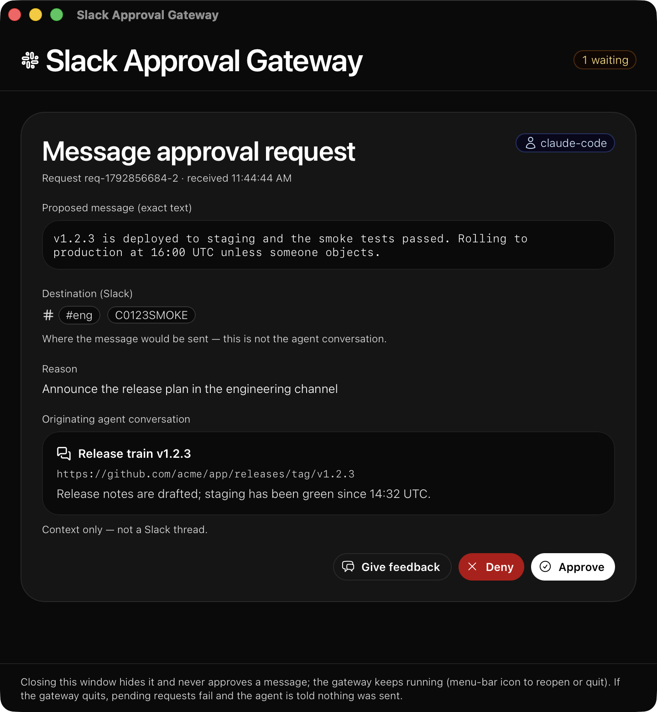

# Slack Approval Gateway

A small, local desktop app (Rust) that is the **approval gateway for
agent-initiated Slack messages**. Agents call one MCP tool,
`request_slack_message`; a human approves, denies, or gives feedback in a
desktop popup; **only the app ever sends to Slack**. Closing or ignoring the
popup never authorizes sending.

```
agent ──MCP/stdio──> slack-approval-gateway ──human popup──> approve / deny / feedback
                            │ (only credential holder)
                            └──────────> Slack MCP server (https://mcp.slack.com/mcp)
                                         or the Mistral Slack Connector
                                         or Korotovsky's Slack MCP server (stdio)
```


**What you get:**

- **Nothing is sent without you.** Every agent-initiated message shows the
  exact proposed text, the exact Slack destination, the reason, and the
  agent conversation it came from — then waits for a human.
- **Exact-send guarantee.** Approval applies only to that request: any
  change to the content or destination requires fresh approval, and
  repeated clicks or retries can never double-send.
- **A real conversation with the agent.** *Give feedback* returns your
  text to the agent (nothing is sent), so it can revise and ask again.
- **Deny means stop.** Denying blocks the same purpose for 10 minutes —
  including reworded requests and retries from other agents — persisted
  across restarts, with no further popups during the cooldown.
- **One gateway, every agent.** All coding agents on the machine share a
  single gateway instance: one popup owner, one Slack client, one set of
  cooldowns.
- **Agents hold no credentials.** The gateway is the only component that
  ever sees a Slack token or API key; the installer audits agent configs
  and can remove direct Slack access from them.

## The approval popup

When any agent asks to send a message, the popup appears (and the app
comes to the front):


What you see, top to bottom:

- **The exact proposed message** — verbatim. What you approve is what is
  sent.
- **Destination (Slack)** — where the message would go, with the resolved
  display name next to the raw ID (`Drake Thomsen (@drake.thomsen)`
  `U0123SMOKE`, `#eng` `C0123SMOKE`), plus the destination thread if the
  agent asked for a reply. This is clearly labeled as *not* the agent
  conversation.
- **Reason** — why the agent wants to send this.
- **Originating agent conversation** — the title, link, and a summary of
  the conversation the request came from (context only — it is never used
  as a destination).
- The requesting **agent**'s identity and the request id/time.

Three actions:

- **Approve** — sends the exact message to the exact destination, once.
  The agent receives the Slack permalink.
- **Deny** — sends nothing and blocks the same purpose for 10 minutes.
- **Give feedback** — opens a text field; *Submit feedback* returns your
  text to the requesting agent without sending anything:


A request to a channel instead of a person looks the same, with `#name`
resolved:



Closing the window only **hides** it — it never approves anything. A
menu-bar tray icon reopens the window or quits the gateway.

## Requirements

- macOS (developed and tested on macOS arm64; Linux should work)
- Rust 1.98+ (`rustup`), Node 24+ (`npm`)
- A Slack **user** OAuth token for the Slack MCP server (default
  transport), a Mistral API key (connector transport), or a Slack **bot**
  or **user** token plus node/npx for the korotovsky transport
  (`SLACK_STDIO_COMMAND` can point at a server binary instead)
- Agents that can run an MCP stdio server on the same machine

## Install

### Quick start

```sh
bash scripts/install.sh                       # optional: --slack-mcp-token xoxp-...
```

This installs the gateway on this Mac end to end:

1. Builds the frontend and the release binary.
2. Installs the binary to `~/.local/bin/slack-approval-gateway`.
3. Creates `~/.slack-approval-gateway/` (mode 700) and writes the credential
   files (mode 600) — the only place a credential lives: `slack_mcp_token`
   for the default Slack MCP transport, `slack_transport` +
   `mistral_api_key` for the Mistral Slack Connector transport, or
   `slack_transport` + `slack_bot_token` / `slack_user_token` for the
   korotovsky transport (below). Without a credential a placeholder is
   written; sends then fail until you install a real one (per-transport
   setup below; the service restarts and reads the files at startup).
4. Installs a LaunchAgent (`com.speakeasy.slack-approval-gateway`) that
   starts the single gateway instance at login (`--serve`: UI + MCP socket,
   no agent on stdio). Logs: `~/.slack-approval-gateway/gateway.log`.
5. Registers the MCP server `slack-approval-gateway` in every detected
   coding agent (table below) and drops a managed instruction block ("read
   Slack context via the Slack MCP server / Mistral Slack connector; send
   only through the gateway") into each agent's instruction file.
6. Audits the exclusivity boundary (below) and prints findings, categorized:
   the official Slack MCP / Mistral connector servers in agent configs
   (expected — agents read Slack context through them), direct token-based
   Slack servers (violations), and Slack/Mistral credentials left in agent
   configs.

Flags: `--dry-run`, `--enforce`, `--uninstall [--purge]`, `--skip-build`,
`--slack-mcp-token xoxp-...`, `--state-dir DIR`,
`--transport slack-mcp|mistral-connector|korotovsky`,
`--mistral-api-key KEY`, `--slack-bot-token xoxb-...`,
`--slack-user-token xoxp-...`. Every modified config file is backed
up once to `<file>.bak-sag`; `--uninstall` restores them.

| Agent | Detected via | Config written |
|---|---|---|
| Claude Code | `claude` | `~/.claude.json` (user scope) + `~/.claude/CLAUDE.md` |
| pdev (paradev) | `pdev` | `~/.paradev/agent/settings.json` + `AGENTS.md` |
| Codex | `codex` | `~/.codex/config.toml` + `~/.codex/AGENTS.md` |
| OpenCode | `opencode` | `~/.config/opencode/opencode.json` + `AGENTS.md` |
| Mistral Vibe | `vibe` | `~/.vibe/config.toml` + `~/.vibe/AGENTS.md` |
| goose | `goose` | `~/.config/goose/config.yaml` + `.goosehints` |
| pi | `pi` | `~/.pi/agent/settings.json` + `AGENTS.md` |
| Gemini CLI | `~/.gemini` | `~/.gemini/settings.json` + `GEMINI.md` |
| Copilot CLI | `~/.copilot` | `~/.copilot/mcp-config.json` + `copilot-instructions.md` |
| Zed | `zed` | `~/.config/zed/settings.json` + `rules/slack-gateway.md` |
| Amp | `amp` | `~/.config/amp/settings.json` |
| Hermes Agent | `hermes` | `~/.hermes/config.yaml` + `AGENTS.md` |

Superset workspaces run these same agent CLIs as this user, so they pick up
the registrations automatically — no per-workspace setup. Devin's CLI (when
present) has no known user-level MCP config; register it manually.

### Verify the install

Restart your agents (or start a new session) so they pick up the new MCP
server, then ask any agent to send you a test message — a DM to yourself is
a good first one:

> "Send me a Slack DM saying 'gateway test'."

A popup should appear with your name as the destination. Approve it: the
message arrives, and the agent gets back a `sent` verdict with the Slack
permalink. Deny it once to see the cooldown behavior (the agent is told
`denied` and a reworded retry comes back `cooldown_blocked` with no popup).

### Choose your sending transport

The gateway sends the approved message through exactly one transport,
selected once per install (or per process via `SLACK_TRANSPORT`):

| | `slack-mcp` (default) | `mistral-connector` | `korotovsky` |
|---|---|---|---|
| Send path | the official Slack MCP server: MCP `tools/call` of `slack_send_message` at `https://mcp.slack.com/mcp` | Mistral Slack Connector tool call (`POST /v1/connectors/{c}/tools/{t}/call`) | Korotovsky's unofficial Slack MCP server (`@korotovsky/slack-mcp-server`), **spawned as a stdio child process**: MCP `tools/call` of `conversations_add_message` |
| Credential the app holds | Slack **user** OAuth token (`slack_mcp_token` / `SLACK_MCP_TOKEN`) | Mistral API key (`mistral_api_key` / `MISTRAL_API_KEY`) | Slack **bot** token (`slack_bot_token` / `SLACK_BOT_TOKEN`, default) or **user** token (`slack_user_token` / `SLACK_USER_TOKEN`) |
| Where Slack credentials live | the app's state dir (a user token) | the **Mistral console** (the connected Slack workspace) | the app's state dir (passed to the child process as `SLACK_MCP_XOXB_TOKEN` / `SLACK_MCP_XOXP_TOKEN`) |
| Needs | a Slack app usable with the official Slack MCP server | a Mistral API key with the Slack connector | node/npx (or a server binary via `SLACK_STDIO_COMMAND`) |
| Agent-facing behavior | identical — same popup, same verdicts, same dedupe/cooldowns | identical | identical |

Which one should you pick?

- **`slack-mcp` (default)** — no bot to install into channels; messages post
  as *you*. Needs a Slack app (for the OAuth user token) whose app is
  directory-published or internal.
- **`mistral-connector`** — if you already use Mistral and want Slack
  credentials off this machine entirely; they live in the Mistral console.
- **`korotovsky`** — if you want a local, open-source Slack MCP server (or
  already run one). Posts as a bot app; the bot must be invited to the
  channels it may post to.

All three enforce the same exclusive-sending path: agents reach Slack only
through the gateway, and the exact approved message still goes to the exact
approved destination (the gateway calls the send tool directly — no LLM in
the send path).

#### Option A: the official Slack MCP server (default)

The gateway sends through the **official Slack MCP server** — a remote MCP
server at `https://mcp.slack.com/mcp` (MCP over Streamable HTTP; JSON-RPC
POSTs, JSON or SSE replies). It authenticates with a Slack **user token**
(`xoxp-…`), not a bot token: the gateway is not a Slack app and never posts
as one. This is the confidential OAuth 2.0 flow Slack documents for MCP
clients — authorize `https://slack.com/oauth/v2_user/authorize`, exchange
`https://slack.com/api/oauth.v2.user.access`.

1. Create a Slack app at <https://api.slack.com/apps>. The app must be
   **directory-published or internal** — only those may use the Slack MCP
   server; unlisted apps are rejected.
2. Under **OAuth & Permissions → Redirect URLs**, add
   `http://127.0.0.1:3118/callback`.
3. Under **OAuth & Permissions → User Token Scopes**, add:
   - `chat:write` — send messages (required);
   - `users:read` — resolve user IDs to display names in the popup;
   - `channels:read` (plus `groups:read` / `im:read` / `mpim:read` for
     private channels and DMs) — resolve channel IDs to `#names`.
   Resolution is best-effort: without these scopes the popup shows the raw
   ID.
4. Get the token — **never give it to the agents** — with the helper:

   ```sh
   scripts/slack_mcp_oauth.py --client-id YOUR_CLIENT_ID --client-secret YOUR_SECRET
   ```

   It opens the Slack authorize page, exchanges the code for a user token,
   verifies it against `https://mcp.slack.com/mcp` (MCP `initialize`), and
   writes it to `~/.slack-approval-gateway/slack_mcp_token` (one line,
   `chmod 600`). Or set `SLACK_MCP_TOKEN` in the gateway's environment, or
   pass it to the installer: `scripts/install.sh --slack-mcp-token xoxp-...`.

Optional environment variables:

- `SLACK_WORKSPACE_DOMAIN` — used only for fallback permalink construction
  when the MCP server returns no link.
- `SLACK_MCP_URL` — override the MCP endpoint (default
  `https://mcp.slack.com/mcp`; used by tests).
- `SLACK_MCP_TOOL` — pin the exact send-tool name (skips discovery). Needed
  if the server's tool list has no name containing "send"/"post" + "message";
  without a pin the gateway discovers it once (first match) and caches it.
- The send tool's argument names are **detected from its declared
  `inputSchema`** — the official server's `slack_send_message` takes
  `channel_id` / `message` / `thread_ts`, and the gateway adapts
  automatically. If the tool declares no schema, the legacy `channel` /
  `text` / `thread_ts` names are used. `SLACK_MCP_CHANNEL_ARG`,
  `SLACK_MCP_TEXT_ARG` and `SLACK_MCP_THREAD_ARG` override the detected
  names. A thread reply to a tool that declares no thread argument is
  refused (nothing is sent).
- `SLACK_GATEWAY_STATE_DIR` — state directory (default
  `~/.slack-approval-gateway`). Holds `cooldowns.json`, `sent.json`, and lock
  files; everything persists across restarts.

#### Option B: the Mistral Slack Connector

The gateway calls the connector's Slack send tool **directly** (no LLM in
the send path). Slack credentials live in the **Mistral console** — the app
never holds them, only a Mistral API key.

1. In the Mistral console, connect your Slack workspace to the **Slack
   connector** (the connector named `slack`). Until the workspace is
   connected there, connector sends fail with
   `No credentials found for connector 'slack'`.
2. Install with the connector transport:

   ```sh
   scripts/install.sh --transport mistral-connector --mistral-api-key "$MISTRAL_API_KEY"
   ```

   This writes `slack_transport` (`mistral-connector`) and `mistral_api_key`
   (mode 600) into the state dir and restarts the service. No Slack token
   is needed or written.

Optional environment variables:

- `MISTRAL_API_KEY` — the key, if not in `<state-dir>/mistral_api_key`.
- `MISTRAL_API_BASE` — override the Mistral API endpoint (default
  `https://api.mistral.ai`; used by tests).
- `MISTRAL_SLACK_CONNECTOR` — connector name or id (default `slack`).
- `MISTRAL_SLACK_TOOL` — pin the exact send-tool name (skips discovery).
  Needed if the connector's tool list has no name containing "send"/"post"
  + "message"; without a pin the gateway discovers it once (first match)
  and caches it.
- The tool's argument names are **detected from its declared `inputSchema`**
  — the `slack` connector's `slack_send_message` takes `channel_id` /
  `message` / `thread_ts`, and the gateway adapts automatically. If the tool
  declares no schema, the legacy `channel` / `text` / `thread_ts` names are
  used. `MISTRAL_SLACK_CHANNEL_ARG`, `MISTRAL_SLACK_TEXT_ARG` and
  `MISTRAL_SLACK_THREAD_ARG` override the detected names. A thread reply to
  a tool that declares no thread argument is refused (nothing is sent).

#### Option C: Korotovsky's Slack MCP server (stdio)

[Korotovsky's `slack-mcp-server`](https://github.com/korotovsky/slack-mcp-server)
is an unofficial, open-source Slack MCP server. The gateway spawns it as a
**child process** and speaks MCP (newline-delimited JSON-RPC) over its
stdio.

1. Get a token — the gateway holds it, agents never see it:
   - **bot token** (`xoxb-…`, the usual choice): create a Slack app at
     <https://api.slack.com/apps>, add the **bot** scopes `chat:write`,
     `channels:read`, `users:read` (plus `groups:read` for private
     channels), install the app to the workspace, and invite the bot to the
     channels it may post to (a bot token sees invited channels only);
     or
   - **user token** (`xoxp-…`) with the same scopes as a user token.
2. Install with the korotovsky transport:

   ```sh
   scripts/install.sh --transport korotovsky --slack-bot-token "$SLACK_BOT_TOKEN"
   ```

   This writes `slack_transport` (`korotovsky`) and `slack_bot_token`
   (mode 600) into the state dir and restarts the service. A user token
   works the same way: `--slack-user-token xoxp-…` (file
   `slack_user_token`). If the server's own `SLACK_MCP_XOX*` variables are
   already in the gateway's environment, the child inherits them and no
   gateway-side token file is needed.
3. The server itself: the gateway runs `npx -y @korotovsky/slack-mcp-server`
   by default (needs node/npx). Point `SLACK_STDIO_COMMAND` at any other
   command line (e.g. an installed binary path; whitespace-separated, no
   quoting).

What the gateway does for you when spawning the server:

- sets `SLACK_MCP_ADD_MESSAGE_TOOL=true` — the server's
  `conversations_add_message` tool is **disabled by default for safety**,
  and the gateway fails at startup if the tool is not listed (your own
  `SLACK_MCP_ADD_MESSAGE_TOOL` value wins if you set one, e.g. to restrict
  posting to specific channels);
- sets `SLACK_MCP_LOG_LEVEL=error` (the server logs to stderr in stdio mode;
  the gateway tolerates non-JSON lines on stdout anyway);
- points the server's user/channel caches (`SLACK_MCP_USERS_CACHE`,
  `SLACK_MCP_CHANNELS_CACHE`) into the state dir, so they stay under the
  app's control and never collide with agent-side instances of the same
  server;
- passes the token as `SLACK_MCP_XOXB_TOKEN` / `SLACK_MCP_XOXP_TOKEN`.

Sending: the send tool is `conversations_add_message` (`channel_id`,
`thread_ts`, `text`, `content_type`). The gateway sends the exact approved
text with `content_type: text/plain` — Slack then renders the exact text,
without markdown interpretation (`SLACK_STDIO_CONTENT_TYPE=text/markdown`
opts into markdown). The server replies with plain text
(`Successfully posted message to channel … (ts=…)`); the gateway parses the
channel and ts out and builds the permalink from them (set
`SLACK_WORKSPACE_DOMAIN` to your workspace's domain for exact links).
Destination display names in the popup come from the server's
`channels_list` / `users_search` tools (CSV replies), best-effort.

Optional environment variables:

- `SLACK_BOT_TOKEN` / `SLACK_USER_TOKEN` — the tokens, if not in
  `<state-dir>/slack_bot_token` / `slack_user_token`.
- `SLACK_STDIO_COMMAND` — the server command line (default
  `npx -y @korotovsky/slack-mcp-server`).
- `SLACK_STDIO_CONTENT_TYPE` — `text/plain` (default) or `text/markdown`.
- `SLACK_STDIO_TOOL` — pin the exact send-tool name (skips discovery).
- `SLACK_STDIO_CHANNEL_ARG`, `SLACK_STDIO_TEXT_ARG`,
  `SLACK_STDIO_THREAD_ARG` — override the argument names detected from the
  tool's declared `inputSchema` (`channel_id` / `text` / `thread_ts`).

#### Manual transport selection

Same precedence everywhere: `SLACK_TRANSPORT` in the gateway's environment
(`slack-mcp`, `mistral-connector` or `korotovsky`), else a one-line
`slack_transport` file in the state dir, else `slack-mcp`. The old `direct`
transport (Slack API calls with a bot token held by the gateway) was removed
on purpose; selecting it now fails at startup with an explanation.

## Using it day to day

### The service

The gateway runs as a login service
(`com.speakeasy.slack-approval-gateway`, started by the installer):

```sh
launchctl kickstart -k gui/$(id -u)/com.speakeasy.slack-approval-gateway   # restart
launchctl bootout gui/$(id -u)/com.speakeasy.slack-approval-gateway       # stop
tail -f ~/.slack-approval-gateway/gateway.log                              # logs
```

After changing a credential file, restart the service — it reads the files at
startup. A menu-bar tray icon offers **Show approval window** / **Quit
gateway** (a left click on the icon also shows the window), and a Dock click
reopens it.

### What the agent receives

| `status` | Meaning |
|---|---|
| `sent` | The exact approved message was sent to the exact approved destination. Includes `ts`, `permalink`, and `duplicate` (true when this was a retry of an already-sent identical request — nothing was resent). |
| `denied` | Nothing was sent. The same purpose is blocked for `cooldown_remaining_secs` (600). |
| `feedback` | Nothing was sent. The human's `feedback` text is returned; the agent may revise and submit a new request, which requires a new approval. |
| `cooldown_blocked` | A matching deny cooldown is active. No popup was shown, nothing was sent; `cooldown_remaining_secs` tells the agent how long to wait. |
| `error` | Nothing was sent. See `error` for details. |

### The rules the gateway enforces

- **Approval is per-request.** Any change to the message content or the
  destination requires fresh approval.
- **No duplicate sends.** An identical retry of an approved request returns
  the cached result (`duplicate: true`) without resending — repeated clicks
  or retries cannot double-send. Sent records persist across restarts.
- **Deny blocks the purpose for 10 minutes**, including reworded requests
  and retries from *other* participating agents. The block is keyed by
  destination + message-content similarity — never by agent identity, reason
  string, or request ID — and is persisted across restarts. While a block is
  active, matching requests get `cooldown_blocked` with the remaining time
  and no popup.
- **Feedback sends nothing** and returns the text to the requesting agent.
- **Closing or ignoring the popup never approves.** If the app quits with
  requests pending, the agents receive an error; nothing is sent.

### One instance, many agents

Every agent spawns the binary over MCP stdio, but there is exactly one
gateway *instance* per state dir: the first process takes `gateway.lock`
and listens on `gateway.sock` (a Unix socket in the state dir); every later
process becomes a byte-transparent *bridge* between the agent's stdio and
that socket (`src/instance.rs`). So there is one popup owner, one Slack
client, one pending-request queue, and one set of cooldowns/dedupe records
(shared on disk in any case). The LaunchAgent instance runs with `--serve`
(UI + socket, no stdio MCP); an instance started by an agent serves both
its own stdio and the socket. A crashed instance leaves a stale lock/socket;
the next starter detects it (the socket refuses connections) and takes
over.

### Headless / CLI mode

```sh
slack-approval-gateway --cli
```

Approvals happen on the controlling terminal (`a` approve, `d` deny,
`f <feedback>`). Concurrent prompts are serialized so an answer always
reaches the right request. `--cli` also becomes the instance and serves the
socket (used by the smoke test). Use this on headless hosts; the popup
needs the desktop app running with access to the window server.

## Agent integration

`scripts/install.sh` registers the MCP server in every agent (table in
*Install*). Manually, each participating agent's MCP client gets a stdio
server, e.g.:

```json
{
  "mcpServers": {
    "slack-approval-gateway": {
      "command": "/absolute/path/to/slack-approval-gateway",
      "args": []
    }
  }
}
```

The per-agent config key/shape differs (see the table in *Install* and
`scripts/agent_config.py`); `scripts/install.sh` handles all of them.
Agents call `request_slack_message` and receive one of the verdicts above.
They do not need the gateway pre-running: the first spawn becomes the
instance, later spawns bridge to it.

The tool requires:

| Field | Meaning |
|---|---|
| `message` | The exact proposed message text. Sent verbatim on approval. |
| `destination` | Intended Slack recipient: channel (`#name` or ID) or user (`@name` or ID). |
| `thread_ts` | Optional. Destination Slack thread timestamp for a reply. |
| `reason` | Why the agent wants to send this. |
| `agent` | Identity of the requesting agent. |
| `conversation` | Context from the originating agent conversation: `title`, `id_or_link`, `summary`. |

Example agent-side call and reply:

```json
{
  "name": "request_slack_message",
  "arguments": {
    "message": "The staging deploy finished and all smoke tests passed.",
    "destination": "U09CV6A19EH",
    "reason": "Tell Drake the staging deploy is ready for review",
    "agent": "codex",
    "conversation": {
      "title": "Staging deploy review",
      "id_or_link": "https://github.com/acme/app/pull/482",
      "summary": "PR #482 passed CI; the staging deploy finished at 14:32 UTC."
    }
  }
}
```

```json
{ "status": "sent", "ts": "1700000000.000100", "permalink": "https://acme.slack.com/archives/U09CV6A19EH/p1700000000000100", "duplicate": false }
```

Agents are **expected** to already have either the official Slack MCP
server (`https://mcp.slack.com/mcp`, OAuth — see
<https://docs.slack.dev/ai/slack-mcp-server/>) or a Mistral connector
server installed; they use those to *read* Slack context (search messages,
list channels, read profiles). The installer detects both, reports them as
expected, and never removes them — the instruction block routes all
*sending* through the gateway regardless. If you install the Slack MCP
server into agents yourself, keep its OAuth grant **read-only** (no
`chat:write` scope) so the agents' token cannot send; the gateway's token
is the only one with `chat:write`.

## Security: the exclusive sending path

The gateway is the **only** component that holds a Slack credential and the
only intended path that sends:

- Agents receive **no** Slack credential (no user or bot token). They may
  have the official Slack MCP server or a Mistral connector server — for
  *reading* Slack context only. Their only way to *send* is the gateway's
  single approval-gated tool. `scripts/install.sh` also writes an
  instruction block into every agent's instruction file: "use the Slack MCP
  server or the Mistral Slack connector to read Slack context; to send,
  call `request_slack_message`; never send through the Slack MCP server's
  send tools (e.g. `slack_send_message`), the Mistral connector's Slack
  tools, curl, webhooks, SDKs, CLIs, scripts, or the browser".
- `scripts/install.sh` **audits** this boundary on every run, in three
  categories: (a) official Slack MCP servers and Mistral connector servers
  in agent configs — **expected** (agents read Slack context through them),
  reported so you can keep their grants read-only; (b) direct token-based
  Slack servers — agents could send through them without the gateway, so
  they are violations; (c) Slack tokens and Mistral API keys found in
  agent configs (masked). The audit also checks the state-dir/token-file
  permissions and the legacy hook guard. `scripts/install.sh --enforce`
  **removes only the category-(b) direct token-based servers** from the
  JSON/TOML agent configs it can edit (anything it cannot edit is reported
  and skipped — remove it by hand); the expected category-(a) servers are
  kept. Originals are restored from `.bak-sag` by `--uninstall`. Removing
  (b) servers also removes agents' Slack *read* access via those servers —
  that is the price of exclusivity; the tokens remain in the `.bak-sag`
  backups, so rotate them in Slack if you want them gone for good.
- A **legacy hook guard** (`~/.config/agent-guards/`, if installed) is the
  deny-by-default backstop for every *other* route: it intercepts tool
  calls that would write to Slack (curl, browser automation, SDKs) and
  blocks them unless you approve them in its dialog. The installer checks
  it (`install.py doctor`) and reports its status. Keep it installed: it
  is what stands between an agent and a direct Slack write when the agent
  does not go through the gateway.
- Prefer running agents as a **separate OS user** that cannot read the
  gateway's state directory (which contains `slack_mcp_token`, or
  `mistral_api_key` with the connector transport). An agent running as the
  same user could read the credential file directly. With the connector
  transport the Slack credentials never touch this machine — they live in
  the Mistral console — so the file to protect is the Mistral API key.
- MCP is stdio (plus the local Unix socket for bridges), so agents must run
  on the same machine as the gateway.
- The korotovsky transport spawns a third-party server process
  (`@korotovsky/slack-mcp-server`) as a child of the gateway: it needs
  node/npx on PATH (or `SLACK_STDIO_COMMAND` pointing at a binary), runs on
  the gateway's machine, and is driven through its MCP tool surface
  (`conversations_add_message`, `channels_list`, `users_search`) — an
  upstream tool rename or reply-format change needs a gateway update (the
  tests pin the expected shapes).
- Keep the token file `chmod 600` (the installer does this).

### Environment limitations (honest list)

- The gateway gates **agent-initiated sends that go through its MCP tool**.
  It cannot stop an agent that already possesses a Slack token (e.g. user
  session tokens `xoxc-`/`xoxd-` left in agent configs — the audit lists
  them), has unrestricted network access, or can drive a browser. The
  mitigations above (no bot token for agents, instruction blocks, the
  legacy hook guard, `--enforce`) reduce, but on a single-user machine
  cannot fully eliminate, this.
- The Hermes agent's native Slack *platform* (`platform_toolsets.slack` in
  `~/.hermes/config.yaml`) is Hermes's own messaging channel, not a
  coding-agent send path; the audit reports it, and the installer does not
  touch it. Remove it there if you want Hermes gated too.
- Purpose blocking is a **heuristic**: destination + normalized
  message-content similarity (character-level Levenshtein ratio ≥ 0.85, or
  token-set Sørensen–Dice ≥ 0.7). It is not a semantic guarantee. Known gaps:
  messages whose accents are encoded as separate combining marks (short,
  heavily accented messages), look-alike letters from other alphabets
  (e.g. Cyrillic "а"), a channel's ID vs its `#name`, and requests already
  queued when a similar request was denied (they still get their own popup).
- A human can of course still send anything manually; the gateway gates
  agents, not people. On macOS, any app with **Accessibility** permission
  can press the popup's buttons, as it can in any app.
- Cooldowns and dedupe rely on the system clock; large clock jumps can
  shorten a cooldown.
- Approval popups require the desktop app to be running with access to the
  window server; use `--cli` for headless hosts.

## FAQ

**Why does every agent message need a human click?**
That is the point: agents cannot message anyone on Slack without you seeing
the exact text and the exact destination first.

**Can I pre-approve an agent, a channel, or a kind of message?**
No — every send is individually approved. The closest thing is *Deny*,
which blocks the same purpose for 10 minutes (see below).

**What happens if I close the popup instead of choosing?**
Nothing is sent. Closing only hides the window; the request stays pending
and the agent keeps waiting. Only quitting the gateway fails pending
requests (the agent is told nothing was sent). Reopen the window from the
menu-bar tray icon.

**What does the agent see when I deny?**
`denied`, plus a 10-minute cooldown on that purpose (destination +
message-content similarity). Reworded retries — and retries from *other*
agents — come back `cooldown_blocked` with the remaining seconds and get no
popup. The block survives restarts.

**What does "Give feedback" do?**
Nothing is sent to Slack. Your text is returned to the requesting agent,
which can revise its proposal and submit a new request — that new request
needs a fresh approval, like any other.

**Can repeated clicks or retries double-send a message?**
No. An identical retry of an already-approved request returns the cached
result with `duplicate: true`; nothing is resent. This persists across
restarts.

**Does approving once cover future similar messages?**
No. Approval is per-request: any change to the message content or the
destination requires fresh approval.

**Which transport should I pick?**
Default `slack-mcp` posts as *you* and needs no bot in channels (but needs
a Slack app for the OAuth token). `mistral-connector` keeps Slack
credentials off this machine entirely (Mistral console holds them). Pick
`korotovsky` if you want a local open-source Slack MCP server — it posts as
a bot app that must be invited to channels.

**Do I need to create a Slack app?**
`slack-mcp`: yes (for the OAuth user token). `korotovsky`: yes (for the bot
token). `mistral-connector`: no.

**The popup shows a raw ID (`U0123…`) instead of a name — why?**
Display-name resolution is best-effort: it needs the read scopes
(`users:read`, `channels:read`, …) and a working lookup tool on the
selected transport. The raw ID is what gets sent either way; resolution is
display-only. With the korotovsky transport the server's caches also warm up
in the background at startup, so the first request after a restart may show
raw IDs.

**The send fails with `channel_not_found` (korotovsky).**
A bot token sees invited channels only — invite the bot to the channel (or
use a user token). With the official Slack MCP server the *user* must be a
member of the channel.

**Why does my message look different in Slack than I approved?**
The gateway sends the exact text as `text/plain` — no markdown
interpretation, no reformatting. (With the korotovsky transport you can opt
into markdown rendering via `SLACK_STDIO_CONTENT_TYPE=text/markdown`.)

**Is my message content sent through an LLM?**
No. The gateway calls the Slack send tool directly (Slack MCP server,
Mistral connector tool call, or the korotovsky server's tool) — no LLM is
in the send path.

**How do I rotate a token or API key?**
Re-run the installer with the flag (it writes the credential file and
restarts the service), e.g.
`scripts/install.sh --transport mistral-connector --mistral-api-key NEW_KEY`,
or edit the file in `~/.slack-approval-gateway/` (mode 600) and restart:
`launchctl kickstart -k gui/$(id -u)/com.speakeasy.slack-approval-gateway`.

**How do I stop or uninstall?**
Stop: `launchctl bootout gui/$(id -u)/com.speakeasy.slack-approval-gateway`
(or the tray icon's Quit). Uninstall:
`scripts/install.sh --uninstall` (removes the registrations, instruction
blocks, LaunchAgent, and binary; restores agent configs from their
`.bak-sag` backups). Add `--purge` to also delete the state dir
(cooldowns, sent records, credential files).

**Can an agent bypass the gateway and send directly?**
It has no credentials to do so. The installer audits agent configs and
`--enforce` removes direct (token-based) Slack MCP servers from them; the
instruction block forbids every other route; and the legacy hook guard
blocks direct Slack writes (curl, browser automation, SDKs) unless you
approve them. See *Security* — and its honest limitations — for what is and
isn't enforceable on a single-user machine.

**Does it work on Linux or headless?**
macOS is the primary, tested target; Linux should work. For headless hosts
run `slack-approval-gateway --cli` — approvals happen on the terminal
instead of the popup.

**Can I use it on another machine or for a team?**
One install per machine: agents must run on the same machine as the gateway
(MCP is stdio plus a local Unix socket), and the state dir is per-user
(`~/.slack-approval-gateway`).

**Where are logs and state?**
Logs: `~/.slack-approval-gateway/gateway.log`. State (mode 700): cooldowns
(`cooldowns.json`), sent-message dedupe records (`sent.json`), credential
files (mode 600), lock/socket, and the korotovsky caches. Everything
persists across restarts.

## Development

```sh
cd ui && npm install && npm run build && cd ..   # frontend (required once)
cargo build --release    # first build compiles Tauri/wry; takes minutes
cargo test               # 81 lib + 14 MCP e2e + 3 instance-socket + 22 Slack
                         # MCP + 18 Mistral-connector + 10 korotovsky-stdio
                         # tests
cargo test -- --ignored  # also the ~30s MCP timeout test
python3 scripts/smoke_test.py        # drives the real binary (mock Slack MCP
                                     # server + mock Mistral API + mock
                                     # korotovsky stdio server + pty + bridges)
python3 scripts/test_agent_config.py # installer config-edit helper tests
bash scripts/install.sh --dry-run    # preview the agent install
```

`docs/SPEC.md` is the module contract (`core` = gateway/cooldowns/dedupe,
`slack` = transport selection + the only credential plumbing,
`slack_mcp` = the Slack MCP server client (default transport),
`slack_stdio` = the korotovsky stdio transport (spawns and drives the
unofficial Slack MCP server as a child process), `slack_tools` = shared
tool-call plumbing, `mistral_slack` = the connector transport, `mcp` =
JSON-RPC server, `instance` = single-instance coordination + stdio bridges,
`ui` = the Tauri webview bridge). GUI behavior is verified by build + spec
review plus the IPC bridge unit tests; the decision flows are covered by
the test suite, the smoke script (which also exercises the bridge path
against a live instance, the connector transport against a mock Mistral
API, and the korotovsky transport against a mock stdio server), and a
manual run of the installed service.

## Layout

```
├── src/core.rs       gateway: validation, purpose fingerprinting, persisted
│                     deny cooldowns, persisted sent-record dedupe, decision flow
├── src/slack.rs      transport selection + the only credential plumbing
│                     (env/file secret readers shared by all transports)
├── src/slack_mcp.rs  Slack MCP server client — the default transport
│                     (remote MCP at https://mcp.slack.com/mcp with a Slack
│                     user token; also resolves Slack IDs for the popup)
├── src/slack_stdio.rs  korotovsky transport — spawns the unofficial Slack
│                     MCP server (@korotovsky/slack-mcp-server) as a stdio
│                     child process and drives it over MCP (bot or user
│                     token held by the gateway; resolves Slack IDs via
│                     the server's channels_list/users_search CSV tools)
├── src/slack_tools.rs  shared tool-call plumbing: send-tool discovery with
│                     schema-adapted argument names + tolerant reply parsing
├── src/mistral_slack.rs  Mistral Slack Connector client (alternative
│                     transport; holds only a Mistral API key)
├── src/mcp.rs        MCP JSON-RPC server (one tool: request_slack_message)
├── src/instance.rs   single-instance coordination: gateway.lock/gateway.sock,
│                     stdio<->socket bridges, stale-lock recovery
├── src/ui.rs         Tauri webview bridge (decision provider + IPC commands)
├── src/main.rs       wiring, run modes (--cli/--serve/default), tray, window lifecycle
├── ui/               the approval popup frontend (React 19 + Tailwind 4 +
│   │                 Once UI @once-ui-system/core + motion-primitives)
│   ├── src/App.tsx        approval popup (Once UI + motion-primitives)
│   ├── src/styles/        globals.css: Tailwind + Once UI tokens/utilities
│   ├── src/lib/utils.ts   cn() helper used by the motion-primitives files
│   └── src/components/motion-primitives/   vendored animated primitives
├── tests/            unit/integration/e2e tests (mock Slack MCP server,
│                     mock korotovsky stdio server, scripted humans,
│                     socket-level instance tests)
├── docs/SPEC.md      behavioral + module contract
├── docs/screenshots/ the approval popup screenshots used in this README
├── scripts/install.sh         one-command install into every agent + LaunchAgent
├── scripts/slack_mcp_oauth.py  Slack MCP user-token OAuth helper (browser flow
│                             + token verification + chmod 600 token file)
├── scripts/agent_config.py    per-agent MCP config editor (backup + idempotent)
├── scripts/test_agent_config.py   tests for the config editor
├── scripts/mock_korotovsky.py  mock of Korotovsky's Slack MCP server (stdio
│                             MCP) for tests + the smoke test
├── scripts/smoke_test.py      end-to-end test of the real binary (incl. bridges)
├── tauri.conf.json, capabilities/, icons/, build.rs   Tauri shell
└── README.md
```
